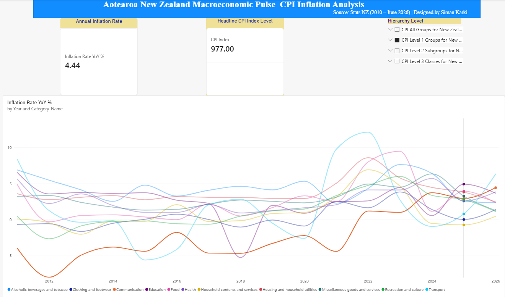

# nz-cpi-inflation-powerbi
Aotearoa New Zealand CPI Inflation &amp; Macroeconomic Pulse (2010–2026) using Power BI and DAX.
# 🇳🇿 Aotearoa New Zealand CPI Inflation & Macroeconomic Pulse (2010–2026)

##  Executive Summary
This project delivers an executive-grade Power BI analytics solution tracking New Zealand's macroeconomic inflation trends using official data published by **Stats NZ** up to the **June 2026 quarter**. Designed from a Business Informatics perspective, this project implements a star-schema architecture, custom time-intelligence DAX measures, and interactive visual reporting to monitor Year-on-Year (YoY) and Quarter-on-Quarter (QoQ) price pressures across key economic expenditure groups.

---

##  Dashboard Preview


---

##  Data Architecture & Engineering
1. **Data Sourcing:** Extracted official consumer price index numbers from Stats NZ (spanning over 10,000+ modern records from 2010 to 2026).
2. **Power Query Transformations:** 
   * Filtered historical noise (pre-2010 records) to optimize model memory performance.
   * Engineered custom M-code integer calculations to convert quarterly period codes (e.g., `2026.06`) into standardized **`Quarter_End_Date`** values.
   * Dropped redundant metadata columns (`STATUS`, `UNITS`, `Subject`) to streamline the schema.
3. **Star Schema Design:** Created a dedicated master calendar dimension table (`Dim_Date`) linked via an active **1-to-Many ($1:N$)** relationship to the CPI Fact table to enable advanced time-intelligence functions.

---

##  Core DAX Measures
Advanced business analytics logic implemented via custom DAX:
- **Headline CPI Index:** 
  ```dax
  CPI Index = AVERAGE('consumers-price-index-june-2026-quarter-index-numbers'[CPI_Index])
  CPI Index Prior Year = CALCULATE([CPI Index], SAMEPERIODLASTYEAR('Dim_Date'[Date]))
  Inflation Rate YoY % = 
VAR CurrentCPI = [CPI Index]
VAR PriorCPI = [CPI Index Prior Year]
RETURN
IF(NOT(ISBLANK(PriorCPI)) && PriorCPI > 0, DIVIDE(CurrentCPI - PriorCPI, PriorCPI, 0) * 100)
- **QoQ Inflation Rate %:** 
  ```dax
  Inflation Rate QoQ % = 
  VAR CurrentCPI = [CPI Index]
  VAR PreviousQuarterCPI = 
      CALCULATE(
          [CPI Index],
          DATEADD('Dim_Date'[Date], -1, QUARTER)
      )
  RETURN
  IF(
      NOT(ISBLANK(PreviousQuarterCPI)) && PreviousQuarterCPI > 0,
      DIVIDE(CurrentCPI - PreviousQuarterCPI, PreviousQuarterCPI, 0) * 100
  )
